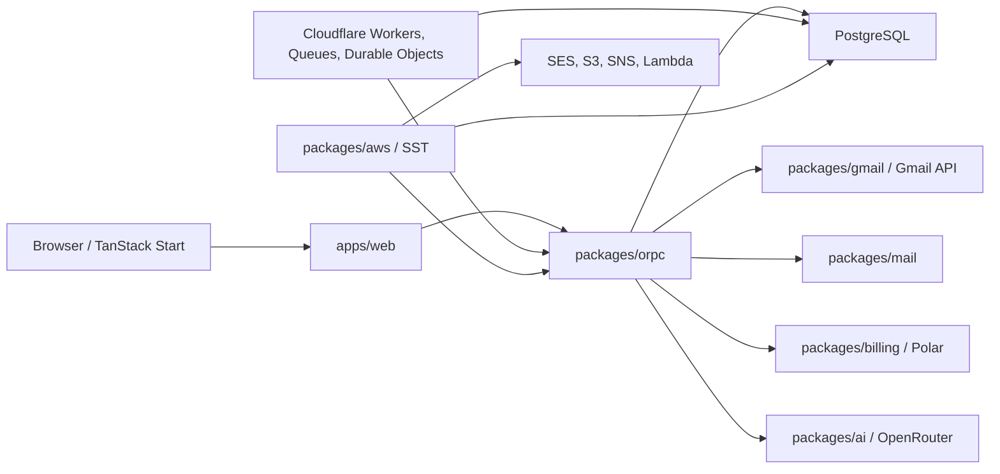

# Architecture

## System Overview

Behavior-producing AI agents share the scoped dynamic knowledge boundary in [`docs/ai-memory.md`](./ai-memory.md). Personal knowledge follows one user, mailbox knowledge follows the mailbox and is more specific, and all retrieval and mutation goes through `packages/orpc/src/ai-memory.ts`.

`apps/web` owns routing, rendering, browser state, server functions, and HTTP API handlers. Database-backed business logic crosses through `packages/orpc`. Shared packages own provider and domain-specific behavior.

## Ownership

An inbox can be shared while each person's connected apps, Action instructions, and Action results stay private. Each user has their own Action configuration for each inbox. Incoming mail can independently trigger each user's Action with that user's exact connected account. Inbox membership never grants access to another person's connections, chat, memory, or Action configuration. A reply draft saved into a shared inbox is shared mail content, so Actions retain the separate draft-access and private-context checks.

Team and organization name the same administrative group. The group controls membership and inbox access. Direct inbox grants bind to the current membership record, so leaving and rejoining does not restore old grants. Billing belongs to the designated payer account and covers the organizations it explicitly funds. Funding does not grant access to private content. See [Action specifications](./action-specifications.md) and [billing](./billing.md).

## Workspace Boundaries

### `apps/web`

Public content lives under the pathless `_public` route layout: `/home`, `/about`, `/contact`, `/privacy`, `/cookies`, `/terms`, and `/imprint`. These pages share theme, consent, opt-in telemetry, and toast feedback, but do not mount the application session, query cache, mail subscriptions, or keyboard shortcuts. Their URLs are unchanged.

The pathless `_app` layout loads application providers through its lazy route component. Inbox, settings, onboarding, authentication, the access gate, and the design system live under this layout. Its query client remains keyed by user identity, preserving cache isolation and cleanup across account changes without remounting public content when a session resolves.

TanStack Start application containing:

- file-based routes and request handlers
- root providers and the HTML document
- mailbox, message, compose, chat, settings, auth, and legal features
- TanStack Query configuration and persisted caches
- consent-gated browser analytics

Mailbox organization separates state, rule actions and editors. Message cards and inspection, domain DNS and mail routing, and connector settings live beside their page controllers in feature-owned modules. Shared types describe their boundaries without importing page rendering at runtime.

API handlers remain under `apps/web/src/routes/api/**`. Request-scoped auth and SSR data use route loaders or TanStack Start server functions.

### `packages/orpc`

The application and database boundary. It owns:

- oRPC routers and authorization
- mailbox access resolution
- chat persistence and streaming orchestration
- Gmail credential encryption and refresh
- managed mailbox operations
- organization mail policy and usage
- billing-backed entitlements

No application module should bypass this package to query PostgreSQL.

The mail router contains procedure registration, transport schemas and route metadata. Services under `packages/orpc/src/mail/` own queries, compose, labels and mutations, including provider selection and authorization. Shared Gmail request handling lives in `gmail-request.ts`; service modules do not import router bootstrapping. Sent-message learning records durable events before responding, and the maintenance worker processes their model updates separately. Gmail feedback metadata reads run in batches of four.

`vp run check:boundaries` checks imports with Oxc, including dynamic imports, re-exports, and type imports. It enforces package/application separation, application database and UI boundaries, and the AWS oRPC entrypoint allowlist. Computed dynamic imports are rejected because their targets cannot be checked. The only application database import allowed is `withRequestDatabaseClient` in the request bootstrap. CI runs this check alongside the AWS and Cloudflare handler bundles.

### `packages/database`

Owns the Drizzle schema, client, migrations, schema-drift checks, and migration safety tooling.

Every Worker invocation uses `withRequestDatabaseClient`; unscoped Worker database access throws. The same client remains available to nested calls and streamed response work. Cloudflare closes invocation sockets automatically, including Hyperdrive connections. Node processes reuse a bounded pool, with one connection in local development and five elsewhere; idle connections close after 20 seconds. See Cloudflare's [connection lifecycle](https://developers.cloudflare.com/hyperdrive/concepts/connection-lifecycle/) and documented [runtime detection](https://developers.cloudflare.com/workers/runtime-apis/web-standards/#navigatoruseragent).

Interactive write requests use database-backed rate limits. The per-minute mail maintenance worker deletes up to 5,000 expired IP buckets per run, using the expiry index and skipping locked rows. The local `mail-recovery` trigger performs the same cleanup. During database failure, each isolate retains at most 1,000 fallback identities and rejects new identities at capacity until entries expire. Signed billing webhooks bypass the interactive login bucket and remain subject to their own signature validation. Read-only requests do not advertise a measured remaining allowance.

### `packages/mail` and `packages/gmail`

`packages/mail` owns shared message, attachment, label, category, and pagination contracts, along with MIME construction, raw parsing, content extraction, draft anchors, and avatar derivation. Both provider adapters return these contracts. The browser's mail helpers live in `packages/app/src/lib/mail.ts`; the web and AI packages have no direct Gmail-package dependency.

Managed rule conditions store stable label IDs. Definition writes hold shared locks on referenced labels until commit. Renaming or deleting a label locks it before repairing legacy name references and updating dependent definitions in the same transaction. Deletion disables affected rules without removing predicates or actions; the organizer explains the missing reference, and saving a repaired definition clears that reason. The nullable rule reason column is an additive migration and must precede the application release.

`packages/gmail` contains Gmail REST calls and Gmail-specific draft parsing. It does not own encrypted credential storage or token refresh.

The composer loads an authoritative draft before mounting an editor. Saves and deletion carry the loaded revision; conflicts preserve local text and offer an explicit copy. Draft lists refresh on mount, focus, and reconnect and are excluded from browser persistence. Saved attachment references include their source message, while the editor uses temporary object URLs that MIME generation replaces with content IDs.

Gmail compose operations use the additive `gmailComposeOperation` table to record draft writes and sends before contacting the provider. A send keeps the same operation ID across manual and assistant requests, recovery, and retries. An uncertain result checks Sent using its recorded Message-ID without issuing another send. Existing Gmail drafts are consumed through draft sending. Managed sends bind each draft revision within the existing billing reservation transaction. The new table migration must run through the protected production workflow before deploying the application; open editors without a loaded revision must reopen their draft.

Maintenance removes obsolete revision-save receipts, definitive rejections, and released locks after 30 days. The latest saved revision, accepted send/create receipts, and unresolved operations remain as recovery and deduplication evidence. Local mail recovery runs the same cleanup and deferred learning processor; model updates remain opt-in locally.

The public SDK derives send inputs from `@quieter/mail/send` and validates responses with the shared delivery schemas. Its build bundles these contracts and permits only Zod and the optional React dependencies in emitted imports. `tsconfig.sdk.json` gives declaration generation a workspace-wide root so the published types include the shared contracts. React rendering lives in `quieter/react`; the core package has no React requirement.

### Other Packages

- `packages/auth`: Better Auth setup, identity scopes, organizations, API keys, passkeys, and auth mail
- `packages/ui`: reusable Base UI-backed components
- `packages/ai`: model configuration with provider fallbacks, prompts, classification, titles, and streamed generation
- `packages/aws`: SES mail ingestion, delivery feedback, and AWS-specific handlers
- `packages/cloudflare`: Gmail notification ingress and direct synchronization, scheduled maintenance, and mailbox live synchronization
- `packages/billing`: plans, Polar checkout/webhooks, entitlements, and usage pricing
- `packages/env`: typed environment schemas and normalization
- `scripts`: SST deployment, local startup, environment checks, and release helpers
- `packages/deployment`: residual SST-generated binding declarations and their TypeScript configuration; no runtime or deployment scripts

## Identity and Mailboxes

Google sign-in and Gmail authorization are separate:

- Google sign-in requests identity scopes only.
- Gmail authorization uses a dedicated OAuth client, PKCE, and Gmail scopes.

Every connected Gmail account and managed address is a persisted mailbox with a stable generated ID.

- Gmail mailboxes remain private to their owner, even when placed in an organization.
- Shared managed mailboxes are organization-owned and visible only through explicit mailbox grants.
- Private managed mailboxes stay organization-owned for billing and domains but belong to one person: only the owner plus explicit member grants can access them, and division grants never apply.
- Private managed owners must remain team members. Offboarding revokes content and grant-management access; team admins can transfer ownership without reading mail.
- Creating a private mailbox, converting to private, or transferring its owner gives only the selected owner access. Conversion and transfer clear existing direct and division grants. Returning to shared preserves explicit member grants and never restores division access automatically. Configuration writes serialize with mode changes on the mailbox row.
- Account deletion requires transferring private managed mailboxes first. A separate restrictive `managedOwnerUserId` foreign key protects organization-owned mail; Gmail retains its existing account-deletion behavior.
- Personal is always available but is not a Better Auth organization.
- `user.defaultMailboxId` is the global fallback across Personal and organizations.

Mailbox-scoped state, queries, caches, chats, compose sessions, and mutations must always include `mailboxId`.

## Gmail Synchronization

The browser initially loads mailbox state through oRPC. Gmail REST work runs server-side.

Unfiltered mailbox views can apply Gmail history updates. Filtered search and Drafts refresh manually. Foreground polling remains the reliability fallback.

For Pro mailboxes:

1. Gmail sends an authenticated notification to the Cloudflare ingress.
2. The ingress validates the Google identity and processes the mailbox history before acknowledging Pub/Sub. A busy mailbox, transient failure, or remaining history page returns a retryable response to Google so backlog work continues.
3. Up to four messages from a history page are processed concurrently; mailbox leases and history cursors keep progress ordered. The worker then sends browser refresh hints.
4. Focused browser tabs receive mailbox-dirty signals from the mailbox Durable Object and refresh immediately.
5. Scheduled Gmail maintenance processes due mailboxes with bounded concurrency for watch renewal and catch-up. The minute mail-maintenance worker retries managed code extraction and removes old processing records that contain no code.

The notification is a wake-up signal, not the source of truth.

Busy deliveries retain a retryable response. The active lease holder may have fetched its history page before the later notification arrived; acknowledging the busy notification would not guarantee that its changes were processed. There is no durable pending-history handoff yet. This accepts the subscription-wide push-backoff tradeoff documented by [Google Pub/Sub](https://docs.cloud.google.com/pubsub/docs/push) to preserve prompt retries for those changes.

### Incoming mail AI

Verification-code screening starts as soon as the message is available, alongside labeling. Gmail messages share one server-side fetch between both tasks; managed messages apply inherited labels and inbox rules after their ingestion transaction commits, then start screening alongside AI labeling. Jev first estimates whether the message could contain a temporary access code. A permissive probability threshold of 0.2 sends possible matches to `google/gemini-2.5-flash-lite` for structured extraction; confident negatives skip extraction. Screening errors or its three-second deadline fall through to extraction. Extraction has a short response, a ten-second deadline, and no SDK or empty-response retries. Both decisions are AI-based; server validation normalizes grouped whitespace and checks that the extracted answer appears in the message, using visible text for HTML. Incoming messages older than two hours, sent mail, drafts, spam, and trash are excluded.

Codes are encrypted at rest, returned only after mailbox authorization, and displayed as small code-only copy controls in message rows and above the matching opened message body. A code's estimated expiry remains internal metadata and does not hide or delete it. Codes are excluded from persistent browser caching. Inbox queries return only the latest code per thread by source-message received time, with processing time as a fallback for legacy rows, while opened messages request their own codes in batches of at most 100; each response is capped at 100 codes. Screen and extraction usage are combined for billing, including messages the screen rules out. A saved code publishes a mailbox update before usage reporting finishes. Failed attempts persist a failure count and next-attempt time with exponential backoff; Gmail and managed-mail selectors and claims skip attempts until they are due. First attempts remain immediate. Existing maintenance retries failed extraction and billing and removes processing records without a code after thirty days, after accounting for reported usage.

Screening reduces cost when enough messages are ruled out, while adding a serial decision request to code-containing messages. At the published rates, an illustrative 1,000-input-token message with 20 extraction-output tokens costs $0.000108 to extract directly, versus $0.000042 plus the extraction cost for messages that pass. At a 10% pass rate, that is approximately 51% cheaper before prompt-length differences, caching, and fallback routing. Screening can miss codes; the threshold favors recall, and extraction remains the fallback for screening failures.

OpenRouter lists [Gemini 2.5 Flash Lite retirement on October 20, 2026](https://openrouter.ai/google/gemini-2.5-flash-lite). Its first configured fallback is Gemini 3.1 Flash Lite, followed by the existing provider failovers; zero-data-retention routing applies to extraction and its fallbacks.

Labels use the pinned `typesafe/jev-1.13` model through OpenRouter's Decisions API, with an independent confidence decision for each label. TypeSafe's direct API and OpenRouter both list $0.042 per million input tokens with free output, so the existing OpenRouter credentials are reused. See the [TypeSafe models](https://docs.typesafe.ai/models) and [OpenRouter integration](https://openrouter.ai/blog/tutorials/how-to-use-jev/).

The useful-details feature, cards, settings, and extraction are removed. Legacy useful-detail RPCs and mailbox response fields remain for one release so existing browser tabs can finish their requests during rollout; remove them in a later contract release. Historical tables and billing categories remain for the rollback window. Deploy the additive verification-code migrations before the application and background workers. Drain the old Gmail queue and prevent its previous consumer from resuming before retiring its infrastructure. The Google push subscription must allow enough acknowledgement time for direct history processing; use its supported 600-second maximum. Mailbox leases serialize capture and history processing for each mailbox. Messages, metadata batches, and sender and domain history searches run sequentially. Per-message memory, labeling, and code tasks finish before the lease is released. Provider throttling preserves pending work and reserves the mailbox through its retry deadline; follow-up notifications defer until that deadline. Different mailboxes remain independent.

## Managed Mail

SST owns standalone inbound and outbound mail infrastructure.

Inbound:

1. SES stores the raw message in S3.
2. SNS invokes the receipt processor.
3. The processor parses the MIME message and writes one row per exact managed recipient. Recipients that match no exact inbox fall through to the domain's whole-domain (catch-all) inbox when one is configured; one delivered message never produces duplicate rows for the same mailbox.
4. Untracked S3 objects are deleted.

Outbound:

- Managed compose and replies send through server-side mail logic.
- `POST /api/send` authenticates an organization API key, requires the `Quieter-Version: 2026-10` compatibility date, and requires a verified sender domain.
- `POST /api/mcp` serves the transactional-mail MCP tool `send_email` over Streamable HTTP with the same organization API key, compatibility date, verified-domain, suppression, idempotency, and usage rules as the REST send endpoint. OPTIONS preflight does not require the date. It exposes sending only: no mailbox, content, or settings access.
- `GET /api/messages/{messageId}` and `GET /api/suppressions` use the same date. `GET /api/o/{token}` is unversioned because mail clients cannot send the header.
- Better Auth email hooks call the same endpoint.

## Chat

The assistant floats over the mail workspace. A square launcher opens it, and conversation history stays in its header dropdown. `chatId` is independent of the selected mail route. Conversations and titles persist, but an interrupted exchange never resumes after reload.

The AI SDK `useChat` hook sends only the newest message and a foreground snapshot to `POST /api/chat`. A TanStack Store coordinates the active generation. Client tools capture snapshots from the controllers that own route, query, and compose state. The shared `@quieter/ai/chat-tools` schemas define client navigation and compose commands and server save and send operations.

Editing a sent message starts a new conversation. The request supplies the source conversation and message IDs. The server checks ownership and mailbox access, copies the saved messages before the edit with fresh IDs, and reserves the revised turn in the same transaction. Copied tool results retain their receipts. Only the new exchange carries foreground authority.

Client tools read the workspace, navigate the real router, or open/edit the real compose controller. Draft revisions reject stale edits. Agent edits do not trigger provider autosave. Server tools retain mailbox ownership checks, credentials, mail operations, and send idempotency. They bind save and send requests to the latest completed workspace read for the active mailbox and generation. Ask mode reviews persistent changes; Automatic permits routine mail changes and draft saves. Sending always requires review of the exact current draft. Foreground continuations use JSON, so drafts with attachments or inline images must be saved or sent from the composer, where the browser still holds the file payloads. Other connector and memory writes keep their explicit approvals.

Each exchange atomically reserves its assistant message ID before streaming or tool effects. A pending browser action or approval gets a lease when the server records it. The browser supplies a fresh request timestamp for each continuation. The server checks the stored lease expiry, compares the rest of the snapshot, and atomically resolves only the recorded pending calls. Browser tool results provide context. Server receipts establish whether mail was sent. Mailbox ownership and provider authorization remain server-enforced. Stop records cancellation, including when it arrives before the initial chat insertion. Before each write, the server checks that the exchange still owns the turn. A provider request already accepted can still take effect after Stop.

OpenRouter can return a rate-limit or upstream failure inside an HTTP 200 event stream. The provider adapter converts those payloads to SDK API errors and checks the stream before its first generated part. Transient startup failures use the SDK's bounded retries and backoff. Once text, reasoning, or a tool call starts, the stream is never replayed automatically. Exhausted retries retain the underlying status for user feedback and server error reporting.

The model chooses when to stream text, call tools, and finish. Independent tools can run in parallel. Tool calls remain available throughout the turn while the user has AI credit. A pending or unconfirmed write blocks another attempt at the same action. A repeated creation or send with the same input in the same turn uses its saved receipt. Gmail changes use provider receipts or read-back to verify the resulting state. Model and tool timeouts bound stalled operations. Stream keepalives keep idle connections open between results, and interruptions retain recorded outcomes in chat history.

Stop, switching conversation or mailbox, browser Back, and trusted editing or navigation in the controlled workspace revoke the client generation. An open session keeps running when the panel is minimized or the tab is hidden. Late client results are discarded, and persisted pending tools become terminal before future transcript conversion. Successful turns refresh history and usage. Title generation can run after the response is saved. Reloading starts a fresh session.

For local verification, start `vp dev apps/web --port 3001 --configLoader native` from an isolated checkout when port 3000 is already occupied. Use the existing preview personas for layout and deterministic tool/continuation tests for the agent flow. Live provider writes require the dedicated development mailbox described in the local-development rules; previewing the panel does not require sending mail.

## Consent and Observability

c15t runs in offline mode. Consent preferences stay in the browser and do not require an API route, database tables, or migrations.

- PostHog and Speed Insights load only after `measurement` consent.
- Client Sentry remains enabled in production and is disclosed in the privacy policy.
- Server-side unexpected failures from the web worker, all Cloudflare background workers, and AWS functions are reported to Sentry; expected user and authorization states are filtered before capture.
- Signup acceptance of Terms and Privacy is separate from analytics consent.

## Billing

Billing subscriptions belong to the payer's account. Each organization names the owner account that funds it, and that account's plan and allowance cover its explicitly funded organizations. Paid plans are `managed` and `pro`. A subscription grants access only while active or trialing and before its current period ends.

Polar handles checkout, renewals, and subscription events. Signed webhooks synchronize subscription status, period dates, and scheduled cancellation. Billing reads reconcile stale records after five minutes, including active and past-due subscriptions, to recover from missed events. Equal provider timestamps can refresh the reconciliation time; older timestamps cannot overwrite newer subscription state. A failed reconciliation returns an unavailable state and retries after five minutes. Checkout refreshes the existing subscription before deciding whether a new checkout is allowed, preventing duplicate subscriptions after a missed renewal.

Canceling at period end preserves access until the period ends. Immediate cancellation, expiry, or past-due status pauses sending, API access, and paid configuration changes. Domains, keys, inboxes, and existing messages are retained. Billing management and authorized deletion remain available. Incoming mail continues for configured inboxes; cancellation does not delete receipt rules or silently discard accepted messages. Full inbound suspension, sender rejection, and a retention deadline are not implemented. Receiving and storage can therefore still incur costs after cancellation.

The additive `cancelAtPeriodEnd` migration must run through the protected migration workflow before deploying code that reads the column. It defaults to false for existing records and is refreshed from Polar on the next reconciliation. No production migration is run from a local checkout.

For private production testing, a 100% subscription discount must cover every intended billing cycle. Check its duration and the discount attached to the affected subscription in Polar. Merchant verification and subscription status are separate; do not bypass production billing checks based on an unverified merchant account. An active subscription with a past period end stays paused until the provider advances the period. Extending access against the old period would also omit new usage from its credit window. See [billing operations](./billing.md) for production setup and renewal troubleshooting. Organization mail usage is measured separately and billed according to plan-specific markup.

## Infrastructure Ownership

Managed mail rules store the matching decision, definition, and completed actions before forwarding. Forwarding uses the send coordinator outside the rule transaction, with a stable identity per action. Ingestion retries resume the stored definition even after a rule edit; explicitly applying an edited rule to existing messages creates a new revision. Historical attempts with uncertain delivery require review.

Historical rule runs advance through the per-minute mail maintenance worker, independently of status polling. Each job stores its definition and checks its lease and running status before updating progress. Cancellation prevents further messages and progress writes; an already executing message can finish. A failure retains the cursor and diagnostic. Running the same rule revision again resumes the failed job. Local execution uses `vp run dev:trigger mail-recovery`.

Apply the consolidated migration `20260907233131_melodic_blacklash` before releasing these changes. Drain older ingestion and rule workers before enabling the new execution path because they do not understand the stored action decisions. Keep the historical application table during this transition.

SST provisions both providers. AWS owns the SES receipt bucket, receipt topic and role, and mail-processing functions. Cloudflare owns Gmail notification processing, scheduled maintenance, and live-sync Durable Objects.

Cloudflare Workers hosts the web application. SST builds and publishes production and binds deployment outputs directly.

### SST configuration layout

The root [`sst.config.ts`](../sst.config.ts) owns only app-wide SST settings and delegates resource composition to [`infra/`](../infra):

- `stage.ts` centralizes stage flags, domains, and deployment environment names.
- `runtime.ts` normalizes `@quieter/env` values and shared Worker/function environment groups.
- `secrets.ts` declares stage-aware `sst.Secret` resources and Cloudflare secret bindings.
- `database.ts` owns the Cloudflare Hyperdrive binding.
- `web.ts` owns the TanStack Start Worker and its common bindings.
- `mail-maintenance.ts` owns the per-minute `MailMaintenance` cron. `packages/cloudflare/src/mail-maintenance-worker.ts` runs send recovery, storage cleanup, expired rate-limit bucket cleanup, and managed rule backfills.
- `mail.ts` owns SES receipt storage, processing, ingress, and send permissions.
- `gmail.ts` owns Gmail live-sync and Pub/Sub resources on Cloudflare.
- `app.ts` is the small stage-aware composition entry point; `types.ts` contains shared infra boundary types.

SST is the runtime source of truth for application credentials and tokens; their canonical names live in `packages/env/src/sst-secrets.ts`. Cloudflare receives them as secret-text bindings, while AWS functions receive values derived from SST secret outputs. Deployment environment variables are reserved for non-secret configuration such as feature switches, resource identifiers, domains, and provider deployment credentials.

## Custom action removal and release

Custom actions, their settings UI, graph execution, queue, dispatcher, and action-specific credit reservations are removed. Connectors remain available to chat, and managed inbox rules remain supported. The new application does not enqueue custom action runs.

The future Actions surface has a standalone versioned JSON contract in `@quieter/ai/action-specification`. It validates mailbox scope, stable connection references, explicit permissions and tool grants, and reviewable parsed output without restoring the retired runtime or changing retained records. See [Action specification contract](action-specifications.md) for validation and authorization boundaries.

Existing action tables and records remain untouched for an expand/contract release. Before rollout, pause old action dispatch and quiesce old producers, then drain in-flight action workers and account for queued retries. Confirm that old consumers cannot resume before removing their infrastructure. Removing code does not stop an already deployed worker. Review uncertain external effects instead of replaying them automatically. Table deletion belongs in a later, separately reviewed contract migration after the rollback window.

Deploy `MailMaintenance` with the application so send recovery, object cleanup, rate-limit cleanup, and managed rule backfills continue every minute. Drain older send, ingestion, and rule workers before enabling the revised recovery paths. No production deployment or migration was performed for this cleanup.

## Migration workflow

Use `vp run db:generate` after a coherent schema change and `vp run db:check` before release. Drizzle generates a full schema snapshot beside each SQL migration and compares snapshots to derive later changes. Keep both files in version control. Large snapshots are expected, even when the SQL is short. See [Drizzle generation](https://orm.drizzle.team/docs/drizzle-kit-generate).

Seven unpublished feature migrations were consolidated into `packages/database/drizzle/20260907233131_melodic_blacklash`. A read-only check of the development ledger confirmed that none of the seven had been applied there. Main-branch migration history is unchanged. Consolidate only unapplied feature migrations, regenerate against the unchanged baseline, and review the SQL and migration checks. Never rewrite applied migration history or reset a persistent database to accommodate consolidation. The consolidated migration must pass the protected release workflow before deployment.
