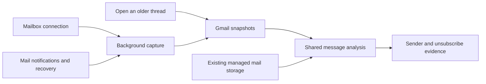

# Server-side mail capture

Server-side capture retains mail for features that must work while a user is offline. Gmail remains the source for browsing, pagination, and provider search. The existing browser cache continues to speed up navigation. It does not control server retention.

## Initial and ongoing coverage

A Gmail connection schedules a background import of 100 recent non-draft messages. The import saves its selected message IDs before fetching bodies, so a retry resumes the same selection. This is an initial import limit. Newly received mail and older opened threads accumulate afterward.

Capture records a history baseline before selecting the initial messages. It replays changes since that baseline after the import, including messages that arrived during the import. Capture has its own progress and lease within the existing background worker. AI settings, credits, and automation failures do not control capture progress.

The stored Gmail content includes message headers, text and HTML, and attachment metadata. Attachment bytes stay at the provider until requested. Stored content has explicit limits and records truncation. Managed mail already retains its content and raw objects, so it keeps that storage rather than copying bodies into the Gmail store.

Opening an older Gmail thread retains its full messages through the same writer. Metadata-only list responses cannot replace a retained body. Drafts remain part of the compose workflow.

## Analysis for future features

Both providers use the same deterministic analysis contract. The analysis records its version, sender identity, mailing-list identity, and unsubscribe evidence. Standard header targets and links found in message content retain their source separately.

Analysis only reads message content. It does not visit links, submit forms, send mail, or unsubscribe the user. A sender advertising one-click unsubscribe does not establish that the target is authenticated or safe to execute. Future actions need their own authorization and target validation. See [RFC 8058](https://www.rfc-editor.org/rfc/rfc8058.txt).

Analysis lives with each provider's canonical message record. Deleting the record also removes its analysis. Existing managed bodies can be analyzed without a provider request. Future semantic search can consume retained text; this change does not generate embeddings or choose a search service.

Sender counts built from these records describe retained coverage. They cannot describe the user's entire historical mailbox after a bounded initial import.

## Replay, recovery, and deletion

Capture persists message content and analysis before advancing its history cursor. A failed write leaves the page available for retry. Mailbox and provider message IDs identify each retained record. Lease fencing protects progress from an expired worker, and provider revisions prevent an older read from replacing newer state.

Label changes update retained state without importing every old message that happens to be relabeled. Permanent deletion clears content and analysis. Minimal deletion records prevent an in-flight old-thread read from restoring deleted content. Disconnecting a mailbox cascades its capture state and retained data.

Gmail history can expire. Recovery resumes across folders from the last reliable capture time and reconciles retained records for deletions. It records incomplete coverage explicitly. Imported messages can have an old internal date, so a time-based recovery cannot prove that every addition survived a history gap. Mail permanently deleted before capture also cannot be recovered. See [Google's synchronization guide](https://developers.google.com/workspace/gmail/api/guides/sync).

## Development and rollout

Use the existing development configuration and local Worker commands. Keep shared Gmail in observation mode with production watch ownership. Snapshot capture uses provider reads; tests must not take over a shared watch or consume the production subscription.

The database change adds storage and optional analysis fields. Apply the additive migration through the protected deployment workflow before deploying code that reads the new tables. Existing mailboxes become eligible for background initialization without reconnecting. Do not run production migrations locally.

The local verification uses a disposable loopback database named `quieter_migration_test`. It covers migration replay and synthetic provider responses without using real mailbox contents, sending mail, or invoking a model. Never run destructive migration tests against `quieter_dev`.

### Encrypted Gmail bodies

When enabled, capture stores text and HTML together in a private R2 object. The AES-256-GCM envelope authenticates the mailbox, message, object, key version, and provider revision at which the body was stored. Label-only updates retain that body revision and reuse the object. Legacy snapshots remain readable during the migration.

Importance search keeps the exact body text as a cleartext SQL projection for substring matching. A positional full-text document preserves phrase matching in text, HTML, headers, and attachment names. Messages that exceed PostgreSQL's vector size limit use overlapping windows for phrase searches and match unquoted terms across all windows. Semantic indexing reads the same text projection and the existing HTML-derived analysis. Treat the search projections, derived analysis, and their indexes as sensitive mail data. PostgreSQL needs `pg_trgm` for the substring index. [PostgreSQL trigram indexes](https://www.postgresql.org/docs/current/pgtrgm.html)

1. Apply the schema and index migrations through the protected workflow. Schedule the concurrent index builds during low database traffic. Deploy all capture readers and writers with `GMAIL_BODY_STORAGE_ENABLED` off. Retire older web versions and drain older background executors before enabling writes.
2. Set the stage's `GmailBodyEncryptionKey` SST secret to 32 random bytes encoded as hex. To introduce a second key, deploy all readers with both keys in the comma-separated secret, then deploy with the new key first so writers select it. Keep keys that still protect stored objects and keep the R2 bucket available to compatible readers, including while new encrypted writes are paused.
3. Enable `GMAIL_BODY_STORAGE_ENABLED` for the stage. Mail maintenance migrates bounded batches of live inline snapshots. It compares the selected revision and snapshot at write time, so retries skip migrated rows and concurrent captures win. Failed rows get a later retry time so other mailboxes can continue. The backlog is the count of live snapshots with no `bodyObject`. Investigate `gmail:body-backfill` failures if the backlog stops shrinking.
4. To pause the backfill and new encrypted writes, turn the flag off and keep the compatible release running. Captures that already point to encrypted objects remain readable.

Uploads run before the transaction that publishes the pointer. The mail object cleanup worker reclaims abandoned staging objects after a day and replaced or deleted objects after an hour. The shorter delay gives in-flight readers time to finish. Mailbox deletion uses the same cleanup queue through the database cascade.

For local verification, use a disposable loopback database with the migrations applied and the native local R2 bucket. Supply a separate development key in the ignored local configuration or its SST secret, enable the flag, and run `vp run env:doctor`. The local mail-recovery trigger runs one backfill batch and the existing cleanup pass. Local capture rejects encrypted writes against the shared development database because the resulting object pointers would only resolve in your local R2 bucket.

## Repair legacy Gmail labels

After all capture workers run the updated metadata writer, run **Administer production mail dispatch and capture** with `repair-capture-labels` to repair older snapshots whose label arrays were stored as JSON strings. The job updates snapshots in primary-key order, commits each page, and reports the number of rows repaired. It preserves message bodies and skips rows already repaired or updated by capture. Re-running the same operation is safe.
