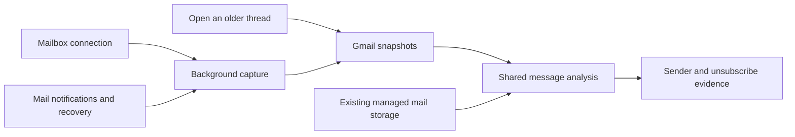

# Server-side mail capture

Server-side capture retains mail for features that must work while a user is offline. Gmail remains the source for browsing, pagination, and provider search. The existing browser cache continues to speed up navigation. It does not control server retention.

## Initial and ongoing coverage

A Gmail connection schedules a background import of 100 recent non-draft messages. The import saves its selected message IDs before fetching bodies, so a retry resumes the same selection. This is an initial import limit. Newly received mail and older opened threads accumulate afterward.

Capture records a history baseline before selecting the initial messages. It replays changes since that baseline after the import, including messages that arrived during the import. Capture has its own progress and lease within the existing background worker. AI settings, credits, and automation failures do not control capture progress.

The stored Gmail content includes message headers, text and HTML, and attachment metadata. Attachment bytes stay at the provider until requested. Stored content has explicit limits and records truncation. Managed mail already retains its content and raw objects, so it keeps that storage rather than copying bodies into the Gmail store.

Opening an older Gmail thread retains its full messages through the same writer. Metadata-only list responses cannot replace a retained body. Drafts remain part of the compose workflow.

## Analysis for future features

Both providers use the same deterministic analysis contract. The analysis records its version, sender identity, mailing-list identity, and unsubscribe evidence. Standard header targets and links found in message content retain their source separately.

Analysis only reads message content. It does not visit links, submit forms, send mail, or unsubscribe the user. A sender advertising one-click unsubscribe does not establish that the target is authenticated or safe to execute. Future actions need their own authorization and target validation. See [RFC 8058](https://www.rfc-editor.org/rfc/rfc8058.txt).

Analysis lives with each provider's canonical message record. Deleting the record also removes its analysis. Existing managed bodies can be analyzed without a provider request. Future semantic search can consume retained text; this change does not generate embeddings or choose a search service.

Sender counts built from these records describe retained coverage. They cannot describe the user's entire historical mailbox after a bounded initial import.

## Replay, recovery, and deletion

Capture persists message content and analysis before advancing its history cursor. A failed write leaves the page available for retry. Mailbox and provider message IDs identify each retained record. Lease fencing protects progress from an expired worker, and provider revisions prevent an older read from replacing newer state.

Label changes update retained state without importing every old message that happens to be relabeled. Permanent deletion clears content and analysis. Minimal deletion records prevent an in-flight old-thread read from restoring deleted content. Disconnecting a mailbox cascades its capture state and retained data.

Gmail history can expire. Recovery resumes across folders from the last reliable capture time and reconciles retained records for deletions. It records incomplete coverage explicitly. Imported messages can have an old internal date, so a time-based recovery cannot prove that every addition survived a history gap. Mail permanently deleted before capture also cannot be recovered. See [Google's synchronization guide](https://developers.google.com/workspace/gmail/api/guides/sync).

## Development and rollout

Use the existing development configuration and local Worker commands. Keep shared Gmail in observation mode with production watch ownership. Snapshot capture uses provider reads; tests must not take over a shared watch or consume the production subscription.

The database change adds storage and optional analysis fields. Apply the additive migration through the protected deployment workflow before deploying code that reads the new tables. Existing mailboxes become eligible for background initialization without reconnecting. Do not run production migrations locally.

The local verification uses a disposable loopback database named `quieter_migration_test`. It covers migration replay and synthetic provider responses without using real mailbox contents, sending mail, or invoking a model. Never run destructive migration tests against `quieter_dev`.
