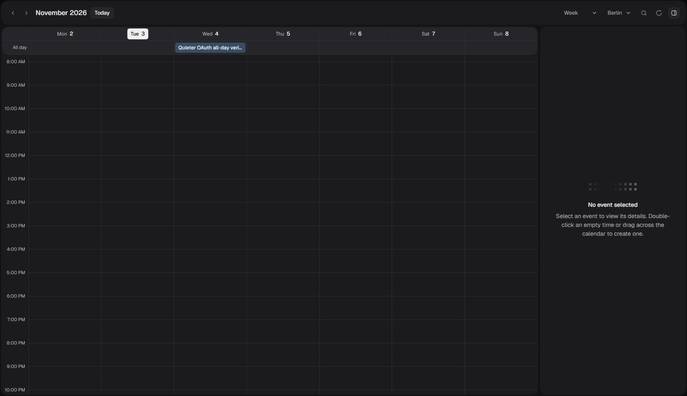

# OAuth connectors

Notion, Todoist, ClickUp, Outlook Calendar and OneDrive use each user's OAuth grant. Credentials stay encrypted and owned by that user. Connecting a service does not share it with the user's organization. Multiple accounts are supported, and reconnecting must select the same account.

## Development setup

Use a separate development OAuth application for each vendor. Outlook Calendar and OneDrive share a Microsoft client registration, but request and store separate grants. All five use this local callback:

```text
http://localhost:3000/api/connectors/callback
```

The callback follows `BETTER_AUTH_URL`. Local testing uses development credentials and the `quieter_dev` database.

| Provider | Registration | Minimum access used here | Development SST Secrets |
| --- | --- | --- | --- |
| Notion | [Connections](https://app.notion.com/developers/connections), OAuth, any workspace | Read content and insert content; no comments or user email required. Users choose pages during consent. Marketplace publication is separate. | `NotionClientId`, `NotionClientSecret` |
| Todoist | [App management](https://app.todoist.com/app/settings/integrations/app-management) or [dynamic registration](https://developer.todoist.com/api/v1/#tag/Authorization/Overview/Dynamic-Client-Registration) | `data:read_write`, authorization code and refresh grants | `TodoistClientId`, `TodoistClientSecret` |
| ClickUp | Workspace settings, ClickUp API, app settings | OAuth access to the workspaces selected by the user; no additional scope parameter | `ClickupClientId`, `ClickupClientSecret` |
| Microsoft | [App registrations](https://portal.azure.com/), Web platform, organizational and personal accounts | Delegated `User.Read`, `Calendars.ReadWrite`, `Files.Read`, `offline_access`; each connection requests only its own resource scopes | `MicrosoftClientId`, `MicrosoftClientSecret` |

Microsoft app registration requires a developer account in an Entra tenant. A personal Outlook account can authorize the finished connector, but a personal account without a directory cannot register its app. See [registration prerequisites](https://learn.microsoft.com/en-us/entra/identity-platform/quickstart-register-app).

ClickUp's settings normalize redirect entries to their host. After entering the full callback, move focus out of the field, save, and wait for **Saved** before leaving. The saved development entry is `localhost:3000`; production is `https://quieter.email`. The authorization request still sends the complete callback path. Reveal the client secret before copying it; the masked input value is not a usable secret.

Use the corresponding uppercase names in the ignored local cache, such as `NOTION_CLIENT_ID` and `NOTION_CLIENT_SECRET`. `CONNECTOR_TOKEN_ENCRYPTION_KEY` must be a development secret. Store credentials in the development SST stage and refresh local bindings:

```bash
vp run secrets:dev pull local-leander
vp run env:doctor
# After adding development credentials to ignored .env.local:
vp run secrets:dev push local-leander
vp run dev:setup
vp run dev:prepare
vp run dev
```

Alternatively, `vp run dev:sst --stage local-leander` loads linked secrets and starts both local runtimes. These connectors do not require Gmail Pub/Sub or background processing. Keep Gmail ownership and telemetry at their existing safe defaults. Apply the committed migration to the verified development database with `vp run db:migrate` before starting the updated app.

## Production setup

The following separate registrations exist as of November 3, 2026. Their client credentials are stored in their corresponding SST stage. Calendar and OneDrive share the Microsoft registration within each stage.

| Vendor    | Development app, `local-leander` | Production app, `production` |
| --------- | -------------------------------- | ---------------------------- |
| Notion    | Quieter Development              | Quieter                      |
| Todoist   | Quieter Development              | Quieter                      |
| ClickUp   | Quieter Development              | Quieter                      |
| Microsoft | Quieter Development              | Quieter Connected Apps       |

Production registrations use `https://quieter.email/api/connectors/callback`. Microsoft registrations belong to the existing Quieter Entra directory and support organizational and personal accounts. The existing `quieter` identity-sign-in registration remains separate. Expired Azure trial credits do not require a new subscription for these registrations.

Both Microsoft client secrets expire on **May 2, 2027**. Before that date, create a replacement in the corresponding registration, update that stage's `MicrosoftClientSecret`, deploy through the protected workflow, verify a connection, and remove the retired secret.

Outlook rejects new monthly rules on the 29th through 31st and yearly rules such as February 29 that could skip nonexistent dates. Outlook moves those occurrences to the month's last day, which differs from the shared calendar's repeat rules. Existing Outlook series retain their native rule when changing only their time. Their month-end rules are preserved when read, with preview unavailable when the shared preview cannot represent them.

Microsoft publisher verification is not complete. Personal Microsoft accounts can grant these delegated permissions themselves. Other organizations can require administrator consent or a verified publisher under their tenant policies. Do not describe Microsoft as universally approval-free. See [delegated access and consent](https://learn.microsoft.com/en-us/entra/identity-platform/delegated-access-primer) and [publisher verification](https://learn.microsoft.com/en-us/entra/identity-platform/publisher-verification-overview).

OAuth registration and secret storage do not deploy the feature. Apply the committed migration and deploy the linked secret bindings through the protected production workflows, then perform production consent and read checks. Development tokens cannot be copied to production because the OAuth clients and encryption keys are separate.

## Manual acceptance

1. Sign in at `http://localhost:3000` and open **Settings**, **Connected apps**. Select an app to view its accounts and access information, then select **Connect account**. Deny one consent request and verify that settings shows a recoverable failure. On the app's detail page, reconnect an existing account from its menu, then select **Add account** to connect a second account where available. Verify that the **Connected apps** breadcrumb and browser Back return to the overview.
2. Open a private chat, choose an account with the `@` picker, and ask for its supported reads. The account mention contains an exact connection ID. A typed provider name alone does not select an account.
3. Notion: share a disposable parent page, search for it, read its blocks, and follow a child block or cursor. Approve creating a page under that parent, then append a paragraph.
4. Todoist: list projects, list tasks in a test project, then approve creating, updating and completing a disposable task. Completing a recurring task advances its occurrence.
5. ClickUp: list workspaces, spaces and lists. Read tasks in a disposable list, then approve creating and updating a test task using one of that list's real statuses.
6. Outlook Calendar: open Calendar, select the Outlook account, read a date range, then create, edit, move and delete a disposable event without guests. Check an all-day event and a recurring event across a daylight-saving transition. RSVP only to an explicitly selected test invitation.
7. OneDrive: list files, search by name and read a small UTF-8 text file. Binary documents are listed but not extracted. No file write tools are exposed.
8. Open an account's menu on its app's detail page and select **Disconnect account**. Cancel the confirmation and verify that the account stays connected. Confirm disconnection and verify that its old mention cannot read or write. An account owned by a second local user must also reject access. Verify that declining a proposed write leaves the provider unchanged.

Local writes are blocked in observation mode. Only after selecting a dedicated test resource, add its exact provider identity to the ignored configuration:

```text
QUIETER_LOCAL_PROVIDER_MODE=write
QUIETER_LOCAL_CONNECTOR_WRITE_ACCOUNTS=todoist:<providerAccountId>,clickup:<providerAccountId>,notion:<providerAccountId>,microsoft_calendar:<providerAccountId>
```

The account IDs are returned by the owned connection lookup. The allowlist is independent of the Gmail, Google Calendar and Linear gates. Return to observation mode after testing. Do not use live shared workspaces for automated write checks. Changes require the existing exact-action review in chat; reviewed mailbox Actions use fixed destinations and approved content bindings.

### Verified development behavior

Live manual checks on November 3, 2026 completed OAuth and API reads for all five connectors. Notion passed private-page search, reads, an approved child-page creation, and block append. Canceling its earlier review left the workspace unchanged. Todoist passed task creation, editing, reading, and completion. ClickUp passed workspace, space, list, and task reads, plus disposable task creation and editing.

Outlook passed calendar reads, event creation and editing, all-day dates, a timed series across Berlin's spring daylight-saving change, rejection of a stale edit, token refresh, and deletion. The all-day event appeared in the shared calendar UI and was deleted there. Both test events were removed. OneDrive passed listing and reading an uploaded UTF-8 text fixture through Microsoft's signed download URL. Different-user access was rejected for each provider.

The private Notion test page, completed Todoist task, ClickUp test task, and OneDrive text file remain available as development fixtures. No guests, invitations, mail sends, or background Gmail processing were used. These checks used personal Microsoft consent, not a separate customer's organizational tenant. Production consent and deployment remain separate rollout checks.



## Current boundaries

OneDrive reads small text files; it does not parse Office or PDF documents. Notion searches only content shared with the integration and exposes page creation and block append, rather than a complete database editor. ClickUp exposes task operations, rather than every workspace feature.

Microsoft organizer meetings with guests are opened in Outlook for changes, because Graph sends invitations automatically and cannot honor the existing silent-update policy. RSVP explicitly sends a response. Calendar colors and `.ics` import remain Google-only. Outlook supports one notification reminder; unsupported recurrence rules fail explicitly instead of being approximated.

OAuth state is single-use, hashed and bound to the current login session. Pending OAuth attempts from before the state-binding migration must be restarted. The migration adds nullable columns and widens provider checks while preserving existing credentials. Replacing checks can briefly lock the affected tables; use the protected production migration workflow before any production rollout.
