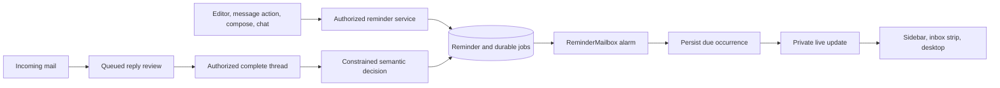

# Personal mailbox reminders

Reminders belong to their creator and a mailbox. A shared mailbox does not make a person's reminders visible to other members. A reminder can stand alone, link to a message, or track an explicit condition in a conversation.

The assistant, reminder editor, message actions, and composer use the same reminder service. Calendar event alarms remain separate provider-owned calendar settings.

## Suggestions and mailbox controls

Deadline suggestions are on by default. A clear, relevant deadline can appear as a compact one-click reminder chip in the message. The chip shows its proposed time, explains why it was suggested, and allows dismissal. Dismissal is saved for that person and message, so reopening the message does not restore the suggestion. Mail without a useful deadline shows no chip.

Automatic reminders are off by default. After a person enables them for a mailbox, only a clear deadline with an explicit date and time can create a reminder automatically. A date-only deadline remains a suggestion that requires acceptance. Promotional deadlines produce neither suggestions nor automatic reminders. Preferences and dismissed suggestions remain private to their owner.

Due and soon reminders appear as a compact stack above inbox rows. Hover leaves the list still. The separate count reveals up to two more single-line rows in normal flow; Escape closes them. Titles open the linked conversation or reminder details. Each row has one completion checkbox and an overflow menu for snooze, edit, and cancel. Completing or snoozing a reminder leaves the disclosure open. Updates appear immediately, and a failed update restores only that reminder.

The sidebar separates **Upcoming** reminders from **History**. **New** starts with a title and time presets. Custom dates, time zones, and reply conditions remain in the detailed editor. A message's clock shows an existing reminder and changes its schedule rather than creating a duplicate. The composer uses one clock to enable a follow-up, then a compact date label to change or remove it. Notification opt-in and automatic reminder preferences live in **Options**.

Chat supports personal reminders in Gmail and managed mailboxes. Managed chat reads conversations through the same authorized query operations as the mail view. Gmail retains its existing mail-tool contract. Successful reminder tools refresh the scoped reminder list even when live updates are unavailable.

## A durable clock and a separate reply check

PostgreSQL owns the reminder, its UTC deadline, its named time zone, and its pending work. A `ReminderMailbox` Durable Object owns one alarm for each creator and mailbox. It reads the next deadline from the database. `MailLiveUser` keeps its existing socket-expiry alarm.

A due reminder stays active until the user completes or cancels it, or a reply review proves its condition fulfilled. Snoozing creates another scheduled occurrence. Configuration versions protect edits from stale decisions. A separate scheduling version prevents a title edit from generating another notification.

Incoming mail requests a semantic review. Receipt alone never completes a reminder. The review reads the established provider-neutral thread contract, including the anchor and subsequent messages. The model returns a bounded verdict and cites supplied evidence. The server checks that evidence before applying the verdict. Acknowledgements, automatic replies, and partial answers retain the reminder unless they satisfy its saved condition.

The due clock does not wait for a model, available credits, or a reply review. A late review can complete an already due reminder. The sidebar shows a failed or pending review without hiding the reminder.

## Sending and retries

The composer stores follow-up intent with the durable send operation before provider dispatch. A confirmed send materializes the reminder using the actual message and thread IDs. Send recovery repeats the same finalization. A failed or uncertain send does not arm a reminder against an invented message.

Creation requests have stable IDs. Due delivery has stable occurrence IDs. Jobs use expiring leases, and updates check their versions before committing. A signed wake request arms the clock after a transaction commits. Maintenance repairs missed wakes and processes semantic work. Alarm rearming is serialized around its bounded database operation.

## Access and notification privacy

Every query and mutation checks the creator and mailbox. Background work checks current mailbox access again. Lost access suspends reminders. Restoring a grant does not silently reactivate them.

Live updates carry opaque identifiers and go only to the creator. Clients fetch reminder content through authorized procedures. Reminder titles, conditions, and mail content do not go to analytics. Native notifications use generic lock-screen text and require an explicit per-account opt-in.

The desktop can notify while running or minimized. Clicking a notification restores the window and opens the relevant mailbox and reminder. Dedupe state is bounded and account-scoped. Signing out clears active notifications and pending session work. A fully quit desktop does not receive notifications. Missed reminders remain visible after reconnecting.

## Timing and rollout

The stored deadline and normal alarm target are precise timestamps. The system never deliberately delivers before that deadline. Cloud execution, network interruptions, sleeping devices, model latency, and operating-system policy can delay visible delivery. There is no transaction spanning PostgreSQL, sockets, and the operating system, so an already displayed notification can race with completion or snoozing. These are at-least-once delivery paths with deduplication, not a hard real-time guarantee.

The database migration adds reminder tables and nullable send intent. Deploy that additive migration before code that queries those fields. Existing releases remain compatible with the added schema. The Worker release adds a new Durable Object class without replacing the socket class or rewriting its migration history. Production migration and deployment use the existing protected workflow.

The design exploration compared a global clock and per-reminder clocks with the selected per-person mailbox clock. The selected design keeps scheduling reconstructible from one indexed scope and avoids a second copy of reminder state. The [Paper designs](https://app.paper.design/file/01M67920912B7N0WCQ8N924QN0/p-6-0) cover the companion list, compact due row, and contextual editor.
