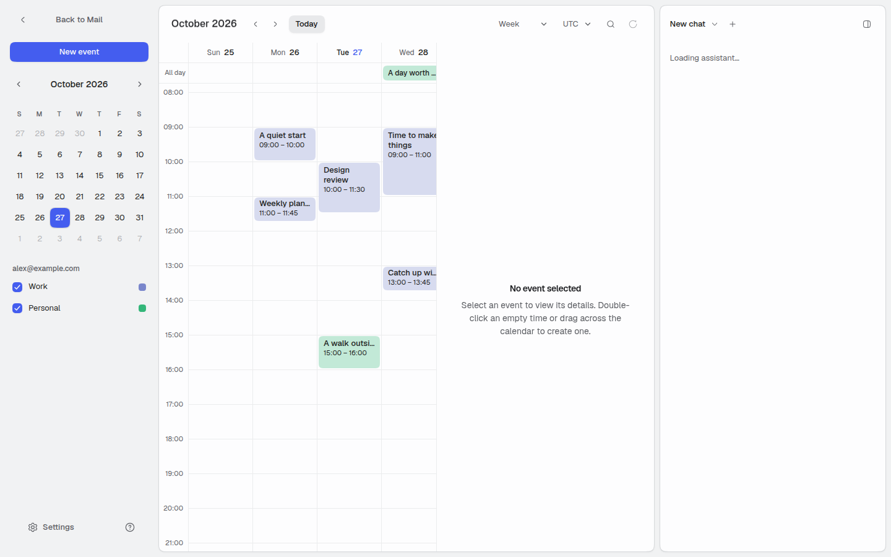
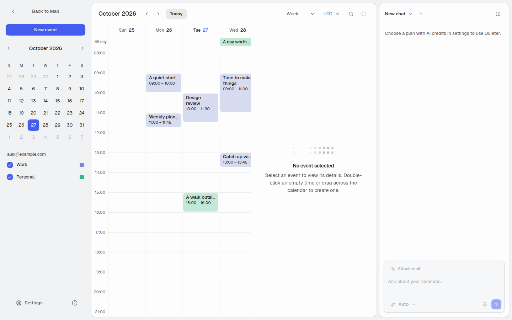
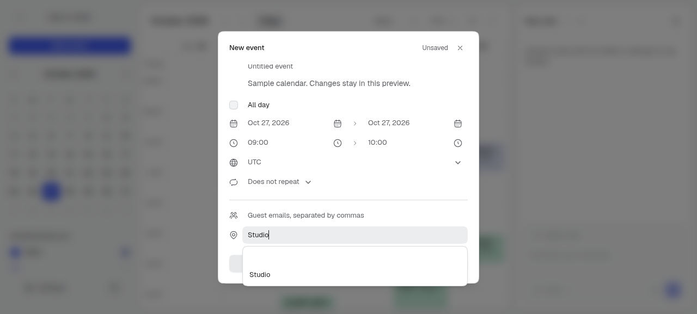
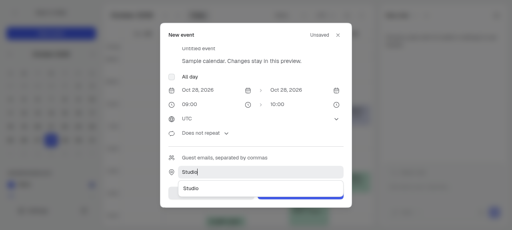
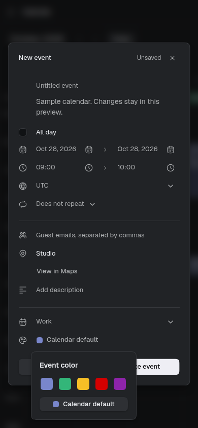

# App responsiveness review

The reported Calendar delay was reproduced in the compiled app, including roughly 1.8-second selection commits with 500 events in a month. The patch removes repeated time-zone calculations, stabilizes derived data, narrows route subscriptions and gives dragging a pointer-driven preview. The assistant keeps its width while it slides; the adjacent content changes width without scaling text.

Source under release verification: `85c61b154fc0e6588512eaeba5dcb750ac22d054`. Parent: `103e2b6e8453fb0fae1ab69fb4860cb5dd2f9fa9`. Final independent release verification is in progress. This report is not yet a merge verdict.

## Changes and evidence

| Area | Result and evidence |
| --- | --- |
| Calendar projection | Compile exact zoned day bounds once per range and retain derived arrays on UI-only updates. Complete outputs matched across week, month and agenda fixtures with 11, 100 and 500 events. In five alternating Node runs, 500-event month projection median was 1026.44 ms before and 17.64 ms after, ranges 976.90–1108.50 ms and 16.58–28.14 ms. This is a pure calculation measurement, not UI latency. [Raw results](projection-comparison.json). |
| Immediate move display | Project pending time-only mutation variables over confirmed data without changing the confirmed cache. A controlled mutation gate verified immediate position, fresh metadata during the request, failure restoration and successful confirmation. [Runtime states](pending-time-display.json). |
| Event dragging | Pointer capture drives a transformed, noninteractive ghost and snapped target guide outside React state. Browser checks covered timed/all-day/month targets, native scrolling, cancellation, no-op/outside drops, keyboard selection and removal of the active source. Detached-source capture loss clears the ghost without an extra drop. |
| Assistant and content | Shared `WorkspaceDock` coordinates main width with fixed sidebar translation. Development checks recorded intermediate main widths and one sidebar width, with no glyph scaling. Mail, compose, snippets, Calendar/details, two-panel mail, narrow overlay, reduced motion, Escape/focus and selection controls were exercised. [Geometry evidence](development-dock-geometry.json). |
| Mail measurement | Individual row observers remain active. Full-list cache invalidation waits for the actual width transition to settle, including reversal and cancellation. The selection toolbar stores action capacity rather than every observed pixel width. |
| Shared subscriptions | Mail roots and chat select only the route fields they consume. Rare account-settings and sign-in links own their href subscriptions. Hidden mail views no longer subscribe to Calendar selection through the full route hook. |
| Compose | Changed text short-circuits HTML normalization, identical editor echoes return early and controller defaults initialize once. Five ordinary development-browser keystrokes went from 20 DOMParser calls to zero. External HTML/format changes, saved and fresh sessions, and sender changes were checked. This count establishes avoided work, not a typing-latency multiplier. |
| Signature ownership | An existing Tiptap serialization bug discarded the owned signature wrapper and duplicated signatures after sender switching. A block node preserves the existing HTML marker; an empty authoring paragraph keeps initial typing outside it. Actual sender switching preserved bold authored content and exactly one current signature. This is a separate fix commit. |
| Mini calendar | Expand only its clipped scroll viewport. Six clipped cells became zero; account-label placement stayed unchanged. [Before](mini-calendar-before.json), [after](mini-calendar-after.json). |
| Colors and location | Include deduplicated used colors and the current draft color. Arbitrary calendar backgrounds remain calendar presets/defaults; explicit event writes retain the provider's valid event-palette contract. Empty autocomplete live-region padding collapses while announcements and keyboard selection remain available. [Before](location-before.json), [after](location-after.json). |
| Labels navigation | Both established Labels entry paths reset the mailbox category so opening Labels from Snippets renders Labels. |

## Coverage

The [coverage matrix](coverage.tsv) records 41 modules inspected across providers, routing, mail lists, detail/body rendering, search, compose, snippets, labels, settings, assistant context/transcripts, shortcuts and shared motion. Calendar projection, query derivation, pending display, schedule rendering and gestures received additional inspection and runtime checks.

The changes follow the existing mailbox-scoped query and mutation contracts. No provider write, message send, production database change or AI call was required for these checks. Fixtures use synthetic preview records through the existing demo storage and query-cache paths.

## Validation and review

- Full `vp check --fix`: zero errors; one existing TanStack Virtual compiler warning. All source commit hooks passed.
- Full `vp test`: 191 files and 1451 tests passed; 26 files and 278 tests skipped by the existing configuration. Focused tests cover time-zone boundaries, all-day/midnight behavior and pending-display identity/metadata rules.
- Independent [source review](source-review.md) found no source blocker across 27 changed/new files. The source review's final-release and large-inbox coverage flags remain release gates. Its decision-trail flag is addressed in the appended [decisions](decisions.tsv).

Fix Root Causes moved expensive work to its range/data owner. Prove It Works requires a final compiled user-flow check. Explain the Number keeps helper timings, development diagnostics and release latency separate.

## Limits

This is a representative app audit, not runtime coverage of every state. Physical-device FPS, Safari/Firefox, trackpad inertia, real AI streams/long transcripts, production-provider writes, sending and billing were not measured. Idle native Calendar scrolling alone did not reproduce the intermittent lag; repeated synchronous projection was a demonstrated source of competing main-thread work.

The installed React Compiler still skips the existing compose surface's unsupported async constructs. Removing a modifier-label effect does not make that surface fully compiler-optimized. No blanket memoization, global timing changes or new motion-value snapshot tests were added.

## Visual evidence

Mini calendar before and after:

 

Location suggestions before and after:

 

Used event colors in the narrow dark layout:

