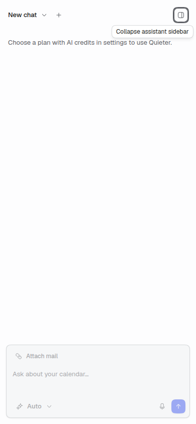

# App responsiveness review

The reported Calendar delay was reproduced in the compiled app, including roughly 1.8-second selection commits with 500 events in a month. The patch removes repeated time-zone calculations, stabilizes derived data, narrows route subscriptions and gives dragging a pointer-driven preview. The assistant keeps its width while it slides; the adjacent content changes width without scaling text.

Application source `978a603164a77243066fac9a0e67661497a9bbc7` independently passes compiled verification with **PASS+NOTES**. Parent: `103e2b6e8453fb0fae1ab69fb4860cb5dd2f9fa9`. The [independent report](final-independent-report.md) and [curated asserted evidence](final-independent-evidence.json) cover the final source. The [PR](https://github.com/quieter-email/quieter/pull/436) records the published-head verdict, CI, merge and release status.

One measured limit remains: the dense 360-thread one-panel inbox has roughly 80–100 ms of row/DOM settling work after a width change. The final measurement change reduces DOM reads; elapsed settling performance is inconclusive. Ordinary two-panel/detail/Compose/Snippets/Calendar transitions did not show that burst. Physical display FPS and every possible app state are outside this evidence.

Timed Calendar comparisons use source `85c61b15`; first-activation/typing comparisons use `8d2ff77d`. Later QA fixes are `bf7d31c7`, followed by row measurement reuse in final source `978a6031`. The compared code and final behavior checks are labeled separately throughout.

## Compiled release comparison

The independent verifier measured source `85c61b15` against the parent using production React in headless Chromium 156, a 1440 × 900 viewport, the supported preview persona, a closed assistant and actual pointer input. Five warm samples per side alternated between parent and head on the same quiet host. Each input selected a different event; both sides rendered the same cards. There was no React DevTools hook or profiler. Timing ends when the selected attribute commits; it is not a measurement of physical display FPS. The later source commits change mail anchoring and workspace code loading; Calendar calculations remain identical.

| Workload | Parent median, range | Head median, range | Evidence |
| --- | --- | --- | --- |
| 500-event month, 126 visible cards | 1808.3 ms, 1732.4–1827.4 ms | 39.1 ms, 36.8–44.3 ms | [Actual inputs](comparison-month-500.json) |
| 11-event week, 11 visible cards | 56.9 ms, 51.5–73.4 ms | 32.8 ms, 28.9–36.4 ms | [Actual inputs](comparison-week-11.json) |

The repeated projection was the demonstrated main-thread bottleneck. After the patch, neither measured head sequence recorded a long task. The retained parent page had duplicate long-task observers, so raw parent entries must be deduplicated by start/duration; no task-count multiplier is claimed. These local results do not guarantee the same times on other devices.

Trusted pointer checks on the compiled 500-event calendar verified drag preview, Escape, no-op and outside drops, lost capture, immediate pending time and confirmed drop time. [Pointer evidence](head-calendar-pointer.json). Six native wheel inputs each moved the real viewport by 120 px with no observed long task. [Wheel evidence](head-native-wheel.json). Scrolling during a drag retained the preview, and cancellation removed it without an extra mutation. [Drag and scroll](head-drag-scroll.json).

The large-inbox check caught a release blocker: settled assistant toggles shifted an intra-row offset from 17 px to 37 px when actual rows changed height. The fix captures the cached anchor before individual row measurements change it and before hidden-view refs reattach. Dirty layout work survives cancellation and view cleanup. Author checks passed six settled toggles, five rapid reversals, responsive row boundaries, breakpoint cancellation, reduced motion, native wheel input and active/settled Calendar round trips. Independent compiled checks now confirm settled changes, rapid reversals, hidden-view return and native wheel input. A separate large thread jump was an invalid measurement: the injected pages held 50 records but the established refetch path reads 15 per page, so refresh truncated the loaded list. The corrected fixture keeps 393 records, 360 threads and 426 source messages in 27 pages.

The broader check found a separate first-open Compose delay. A fresh empty editor's chunk finished in 10.6 ms, but a throttled React commit held the editor until 392.6 ms. The click task took 49 ms and the eventual commit took 52 ms. The CPU trace mapped the wait to the installed renderer's fallback reveal timer; [React documents this reveal behavior](https://react.dev/reference/react/Suspense#caveats). [Sanitized diagnostic](cold-compose-diagnostic.json). Snippets and the assistant independently showed the same code-reveal wait. Assistant plan-fetch time was measured separately using its complete actual response in the established query cache.

One typed owner now loads these three modules through ordinary pending/ready/error state and caches only resolved code. The real components receive current props when loading completes. Moving the Suspense boundary and grouping navigation in a transition did not remove the delay in the rejected prototype. Existing loading treatments and error boundaries remain available. Public preload promises are observed and returned unchanged so intent warming remains safe while mounted consumers still receive failures. Three focused tests pass; restoring an async outer wrapper makes all three fail on unhandled rejection.

The final source `8d2ff77d` was rebuilt and compared with the parent in five alternating fresh-document runs per side on a quiet host. Compose and Snippets retained 500 cached calendar events and the complete mail fixture. Fields/body were empty, and real first input reached the focused editor/search field. The assistant comparison warms each browser's own complete actual billing response through the established cache, separating code readiness from account-data time. No plan response was invented or account check changed.

| First activation | Parent ready median, range | Final ready median, range | Raw evidence |
| --- | --- | --- | --- |
| Compose editor | 372.7 ms, 364.8–388.2 ms | 98.0 ms, 95.8–132.0 ms | [Compose](comparison-compose-cold.json) |
| Snippets search | 335.2 ms, 334.1–344.6 ms | 48.4 ms, 46.9–75.0 ms | [Snippets](comparison-snippets-cold.json) |
| Assistant body, actual plan response warm | 338.5 ms, 329.1–344.7 ms | 100.7 ms, 80.2–145.6 ms | [Assistant](comparison-sidebar-cold.json) |

The median next animation-frame opportunity also fell from 944.1 to 99.6 ms for Compose and from 911.0 to 49.1 ms for Snippets, consistent with removing the competing hidden Calendar work. These are browser callbacks after the real DOM commit, not display presentation timestamps. A separate single ordinary assistant load, including the actual account-data request, took 509 ms before and 294 ms after. Its input remained disabled under the existing account rules. [Full ranges and geometry summary](comparison-first-reveal-summary.json).

In those five first assistant openings, the parent main panel recorded one width while the final source recorded 14–15 intermediate widths; final sidebar width stayed exactly 374.390625 px. Warm desktop checks across two-panel mail, message detail, Compose, Snippets and Calendar recorded 13–16 widths and preserved text/selection. The corrected complete inbox fixture passes all five rapid reversals with the same thread and exact intra-row offset. [Reversals](head-final-reversal-summary.json), [hidden-view lifecycle](head-final-inbox-activity.json), [native wheel during motion](head-final-inbox-user-wheel.json).

All six compiled module failure/late-completion cases pass. Deliberately failed Compose, Snippets and Chat code reaches the established error screen with zero unhandled preload rejections, returns to Inbox and loads normally after network restoration/reload. Late completions preserve the requested Inbox or closed sidebar and do not steal focus. Healthy recovery starts fresh error counters before page JavaScript and records zero errors/rejections. [Loader gates](head-loader-gates.json).

Five alternating native typing recordings per side accept the expected text in empty and 21 KB bodies. Each five-key window triggered 25–26 HTML parses in the parent and zero in the final source. This establishes avoided parsing; a warm typing latency multiplier is not claimed. [Typing work and outputs](comparison-typing.json).

## Keyboard and mobile QA

Compiled keyboard testing found an existing interception bug: Enter on the focused native Compose button opened the first email instead. The fix lets a focused control handle Enter and preserves the established global list-row activation path. The hotkey manager's automatic cancellation is disabled for this one shortcut and applied only after the event belongs to the list. The author and independent verifier both reproduced the old behavior and verified the real trusted button click afterward. [Before](keyboard-control-before.json), [after](keyboard-control-after.json), [focused source review](keyboard-review.md).

The compiled `bf7d31c7` checks pass native Compose, Snippets, Calendar-link and assistant activation; body/row Enter, J/K navigation, selection-button behavior, checkbox behavior and direct routes. [Keyboard flows](release-keyboard-flows.json), [direct activation](release-keyboard-direct.json).

At 390 px, Calendar's sticky header previously escaped above the assistant. Isolating the main panel contains its child stacking layers. The rebuilt overlay paints correctly, background content stays inert, Escape restores visible keyboard focus and reduced motion removes sliding while retaining the inbox anchor/selection. The desktop event-color popup remains portaled outside both panels and passes the actual hit test above them. [Responsive/focus](release-responsive-focus.json), [desktop portal](release-desktop-portal.json).

## Bounded row-measurement investigation

The 360-thread one-panel stress case still recorded 80–100 ms tasks while row measurement and DOM commits settled after width motion. Ordinary two-panel/detail/Compose/Snippets/Calendar toggles did not show those tasks. A separate diagnostic identified repeated viewport `clientWidth` and row `offsetHeight` work. Two small candidates were compared without changing layout state or adding effects.

The retained change delegates size acquisition to the installed TanStack helper and checks viewport width only when actual row size changes. Cached ref sizes remain observed through ResizeObserver; zero/hidden sizes retain the previous fallback. The author verified all previous anchor/lifecycle gates and a controlled row whose actual DOM height changed 48→73 px. The [independent source review](measurement-review.md) confirms that the helper leaves caches untouched before anchor capture and retains live observation.

Five alternating compiled open/close pairs compare `bf7d31c7` with `978a6031`, using the same canonical whole-data hash, 3086 DOM nodes, theme, viewport, query and loaded records. Maximum recorded long-task medians are 80.5 ms before and 81.5 ms after; ranges are none–99 ms and 70–94 ms. Zero in the raw summary means no recorded task crossed the Long Tasks API threshold. The difference is inconclusive, so the report claims reduced work rather than a settling-latency win. [Timing summary](comparison-settle-summary.json), [raw paired runs](comparison-settle-release.json).

A separate instrumented production run records viewport-width reads of 174/195 before versus 28/26 after for open/close; row-height reads are 505/634 versus 41/135. Instrumentation is restored before timing. Every case retains the same thread, exact 17 px intra-row offset, selection and complete work. [DOM-read counts](comparison-settle-release-reads.json).

## Changes and evidence

| Area | Result and evidence |
| --- | --- |
| Calendar projection | Compile exact zoned day bounds once per range and retain derived arrays on UI-only updates. Complete outputs matched across week, month and agenda fixtures with 11, 100 and 500 events. In five alternating Node runs, 500-event month projection median was 1026.44 ms before and 17.64 ms after, ranges 976.90–1108.50 ms and 16.58–28.14 ms. This is a pure calculation measurement, not UI latency. [Raw results](projection-comparison.json). |
| Immediate move display | Project pending time-only mutation variables over confirmed data without changing the confirmed cache. A controlled mutation gate verified immediate position, fresh metadata during the request, failure restoration and successful confirmation. [Runtime states](pending-time-display.json). |
| Event dragging | Pointer capture drives a transformed, noninteractive ghost and snapped target guide outside React state. Browser checks covered timed/all-day/month targets, native scrolling, cancellation, no-op/outside drops, keyboard selection and removal of the active source. Detached-source capture loss clears the ghost without an extra drop. |
| Assistant and content | Shared `WorkspaceDock` coordinates main width with fixed sidebar translation. Development checks recorded intermediate main widths and one sidebar width, with no glyph scaling. Mail, compose, snippets, Calendar/details, two-panel mail, narrow overlay, reduced motion, Escape/focus and selection controls were exercised. [Geometry evidence](development-dock-geometry.json). |
| Mail measurement | Individual row observers remain active. Full-list cache invalidation waits for the actual width transition to settle, including reversal and cancellation. The selection toolbar stores action capacity rather than every observed pixel width. |
| Shared subscriptions | Mail roots and chat select only the route fields they consume. Rare account-settings and sign-in links own their href subscriptions. Hidden mail views no longer subscribe to Calendar selection through the full route hook. |
| Compose | Changed text short-circuits HTML normalization, identical editor echoes return early and controller defaults initialize once. Five ordinary development-browser keystrokes went from 20 DOMParser calls to zero. External HTML/format changes, saved and fresh sessions, and sender changes were checked. This count establishes avoided work, not a typing-latency multiplier. |
| First workspace activation | Compose, Snippets and assistant share typed code loading with the complete existing loader/prop contracts. Fresh-document click, keyboard and direct routes accept real input. Held-load navigation and mailbox switching retain the latest view/mailbox. Failed loads remain visible and recover through the existing route UI. [Development behavior](development-loading-behavior.json), [mailbox switch](development-loading-mailbox-switch.json), [interruption and failure](development-loading-failure.json). |
| Signature ownership | An existing Tiptap serialization bug discarded the owned signature wrapper and duplicated signatures after sender switching. A block node preserves the existing HTML marker; an empty authoring paragraph keeps initial typing outside it. Actual sender switching preserved bold authored content and exactly one current signature. This is a separate fix commit. |
| Mini calendar | Expand only its clipped scroll viewport. Six clipped cells became zero; account-label placement stayed unchanged. [Before](mini-calendar-before.json), [after](mini-calendar-after.json). |
| Colors and location | Include deduplicated used colors and the current draft color. Arbitrary calendar backgrounds remain calendar presets/defaults; explicit event writes retain the provider's valid event-palette contract. Empty autocomplete live-region padding collapses while announcements and keyboard selection remain available. [Before](location-before.json), [after](location-after.json). |
| Labels navigation | Both established Labels entry paths reset the mailbox category so opening Labels from Snippets renders Labels. |

## Coverage

The [coverage matrix](coverage.tsv) records 42 modules inspected across providers, routing, mail lists, detail/body rendering, search, compose, snippets, labels, settings, assistant context/transcripts, shortcuts and shared motion. Calendar projection, query derivation, pending display, schedule rendering and gestures received additional inspection and runtime checks.

The changes follow the existing mailbox-scoped query and mutation contracts. No provider write, message send, production database change or AI call was required for these checks. Fixtures use synthetic preview records through the existing demo storage and query-cache paths.

## Validation and review

- Full `vp check --fix` on final source: zero errors; one existing TanStack Virtual compiler warning across 1048 files. All source commit hooks passed.
- Full `vp test` on final source: 192 files and 1454 tests passed; 26 files and 278 tests skipped by the existing configuration. Focused tests cover time-zone boundaries, all-day/midnight behavior, pending-display identity/metadata and preload rejection ownership.
- Remote [CI for the source commit](https://github.com/quieter-email/quieter/actions/runs/40616042254) passed lint/type checks, both supported test runtimes, deployment safety, web-worker build and migration integration. The [PR](https://github.com/quieter-email/quieter/pull/436) records final artifact checks and release status.
- Independent [initial source review](source-review.md) covered 27 changed/new files. The [delta review](source-review-final.md) checked six exact file hashes after the runtime-discovered fixes and found no blocker. Focused [keyboard](keyboard-review.md) and [measurement](measurement-review.md) reviews cover the later changes. Final compiled verification passes the eight-view matrix, dense-state lifecycle, gestures, keyboard/mobile/reduced-motion/portal behavior, direct loading and failure/race recovery with zero unexpected errors/rejections. See the [asserted evidence](final-independent-evidence.json) and appended [decisions](decisions.tsv).

Fix Root Causes moved expensive work to its range/data owner. Prove It Works required actual compiled input and state checks. Explain the Number keeps helper timings, development diagnostics and release latency separate. Encode Lessons in Structure added the public-loader regression test after an autofix broke rejection ownership.

The final [comment review](comment-review.md) kept the functional promise-ownership exception and the brief loading-owner explanation. The regression test encodes the autofix failure instead of relying on the comment alone.

## Limits

This is a representative app audit, not runtime coverage of every state. Physical-device FPS, Safari/Firefox, trackpad inertia, real AI streams/long transcripts, production-provider writes, sending and billing were not measured. Idle native Calendar scrolling alone did not reproduce the intermittent lag; repeated synchronous projection was a demonstrated source of competing main-thread work.

The installed React Compiler still skips the existing compose surface's unsupported async constructs. Removing a modifier-label effect does not make that surface fully compiler-optimized. No blanket memoization, global timing changes or new motion-value snapshot tests were added.

## Visual evidence

Mini calendar before and after:

 

Location suggestions before and after:

 

Used event colors in the narrow dark layout:

