# Product visual review

This pass addresses typography, icon treatment, hierarchy, and contrast across the shared web and desktop product. Geist remains the product font, with the same self-hosted font source in web and desktop. Compact workspace headings use 16px, dense UI uses 13px, and metadata uses 12px. Weight and color distinguish labels from supporting text. Conversation subjects, workspace titles, and row labels stay on one line with ellipses when needed. Help and message content wrap normally. Default panels use flat backgrounds. Original desktop and control radii remain in place. Mobile workspace panels are edge to edge without an outer frame or gutter. Product icons use one shared stroke, size, tone, and loading contract.

The [Capy reference](https://capy.ai/) informed the restrained controls and clearer hierarchy. Marketing sources and artwork were kept separate.

Preferences now includes a device Mail layout choice. Two panels is the default. One panel uses the full list width, then opens a full-width conversation with Back. Both the mailbox and All inboxes paths retain their existing data, actions, and route state. Shared row variants use a shorter horizontal layout with aligned columns when the actual list container has enough width, including beside the assistant. Rows fill the list width with square corners and subtle separators. Both layouts use smaller shared sender logos. Selection retains the golden importance accent. Message-header actions stay visible, the importance flag reflects the saved state, and successful unsubscribe requests keep a checked control after reload. Add mailbox uses the shared Settings layout instead of the viewport-sized onboarding shell.

There are 39 matched views and 16 additional views of the new layouts, controls, and mailbox setup, with 94 screenshots in total. Desktop captures use 1440 by 960 pixels. Narrow captures use 390 by 844 pixels. Mail, names, and addresses come from the existing synthetic preview personas. Demo timestamps reflect capture time. Matched screenshots use the same scenarios, themes, assistant state, and viewports.

The sign-in and onboarding shader sources are unchanged. Their original baseline browser had no available graphics adapter. The final captures enable WebGPU in a headed browser and wait for the shader to render, so the stronger background in those comparisons is a capture correction. Reduced motion freezes the shader but still draws it.

The before images were captured before presentation edits at [the starting revision](https://github.com/quieter-email/quieter/commit/d4605384045fe9515b853e18092f5a39e1c95d5d). The [baseline commit](https://github.com/quieter-email/quieter/commit/56491cad4b854a77d8542d2719010beebfc60d74) contains the capture recipe and original images.

## Verification

[Check output](checks.txt) records the lint, type, test, boundary, and production-build runs after merging current main. The tests reported 1,240 passed and 278 skipped. The full check reported three existing React compiler warnings. Web and desktop builds passed. Native Electron sign-in and OS integration were not exercised.

[Contrast results](contrast.json) cover ten themes, five solid backgrounds, categorical and state-colored pills, foreground and muted text, action states, and the focus color. These samples meet 4.5:1 for text and 3:1 for focus color. The weakest sampled pill is 4.57:1. The browser resolves CSS colors through Canvas before measuring sRGB luminance. Its isolated color probe disables transitions so reduced-motion color transitions cannot return a previous sample. The sample uses each gradient's surface endpoints and a conservative 15 percent pill tint. It does not establish the accessibility of arbitrary email HTML, user-selected colors, every component state, or the whole application.

Chrome checks also covered visible keyboard focus on search and invalid input, dialog Tab navigation, Escape dismissal and focus restoration, truncated conversation headings, and full-width dialog actions. Layout checks covered saved choices, fallback for absent or invalid storage, direct links, browser Back, and retained search context in both inbox paths. A [scrolled-list check](mail-layout-runtime.json) used 440 synthetic messages through the existing demo store. Keyboard open, hidden resize, and Back restored focus in both width directions without mixed virtual row sizes or gaps. Mobile mail and setup panels fill all 390 pixels without an outer border, gutter, rounding, or horizontal overflow. The assistant screenshot shows its initial disabled composer. Provider generation, real sending, OAuth, billing checkout, and account deletion were not performed. The shared development database lacks the existing memory-bootstrap table, so the Memories flow remains unverified. The work introduces no schema or provider changes.

## Reproduce the captures

Use the existing development setup in [the development guide](../../development.md). Copy approved development configuration into the ignored worktree location and run `vp run env:doctor`. Keep telemetry and provider writes disabled. Build the environment and observability packages before starting a fresh checkout.

```bash
vp install --frozen-lockfile
vp run @quieter/env#build
vp run @quieter/observability#build
vp run env:doctor
vp dev apps/web --port 3024 --host 127.0.0.1 --configLoader native
```

Choose an unused loopback port and set `BETTER_AUTH_URL` to that origin. In a second terminal, run the capture script against it.

```bash
vp exec node scripts/capture-product-ui.ts after http://localhost:3024
```

The capture script pins agent-browser 0.39.2 and uses `--webgpu --headed`. Linux needs Xvfb and a working graphics adapter. Use `--contrast-only` to rerun its color samples without recapturing screenshots. The script signs in through the established preview UI for full captures. This creates synthetic development-account records. It never connects a real mailbox or sends mail. It captures the listed states, samples contrast after CSS loads, and closes its own browser session. To record a baseline for another change, run the script with `before` before making presentation edits.

## Screenshot comparisons

<details>
<summary>Desktop light, 16 comparisons</summary>

| View | Before | After |
| --- | --- | --- |
| Inbox |  |  |
| Conversation and attachment |  |  |
| Compose |  |  |
| Structured search |  |  |
| Labels |  |  |
| New label dialog |  |  |
| Snippets |  |  |
| Snippet editor |  |  |
| Preferences |  |  |
| Keyboard shortcuts |  |  |
| Account |  |  |
| Connected apps |  |  |
| Mailboxes |  |  |
| Add a mailbox |  |  |
| Assistant |  |  |
| Shared component reference |  |  |

</details>

<details>
<summary>Desktop dark, 16 comparisons</summary>

| View | Before | After |
| --- | --- | --- |
| Inbox |  |  |
| Conversation and attachment |  |  |
| Compose |  |  |
| Structured search |  |  |
| Labels |  |  |
| New label dialog |  |  |
| Snippets |  |  |
| Snippet editor |  |  |
| Preferences |  |  |
| Keyboard shortcuts |  |  |
| Account |  |  |
| Connected apps |  |  |
| Mailboxes |  |  |
| Add a mailbox |  |  |
| Assistant |  |  |
| Shared component reference |  |  |

</details>

<details>
<summary>Narrow layouts, 5 comparisons</summary>

| View | Before | After |
| --- | --- | --- |
| Inbox light |  |  |
| Conversation and attachment light |  |  |
| Compose dark |  |  |
| Preferences dark |  |  |
| New label dialog light |  |  |

</details>

<details>
<summary>Sign in and onboarding, 2 comparisons</summary>

| View | Before | After |
| --- | --- | --- |
| Sign in dark |  |  |
| Onboarding dark |  |  |

</details>

## New layouts and controls

These are additional current-state views. The earlier version has no one-panel preference or persistent unsubscribe confirmation to compare.

| View | Screenshot |
| --- | --- |
| One-panel inbox, light | 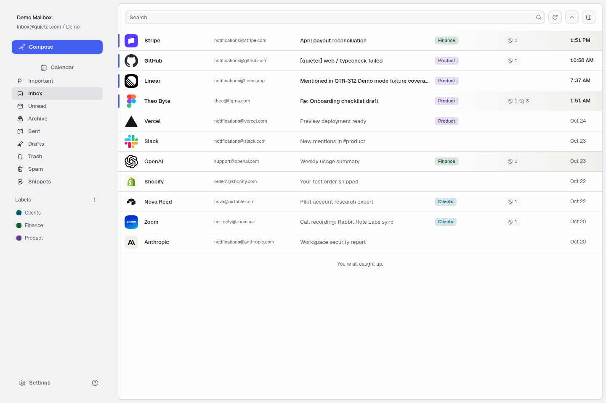 |
| One-panel conversation, light | 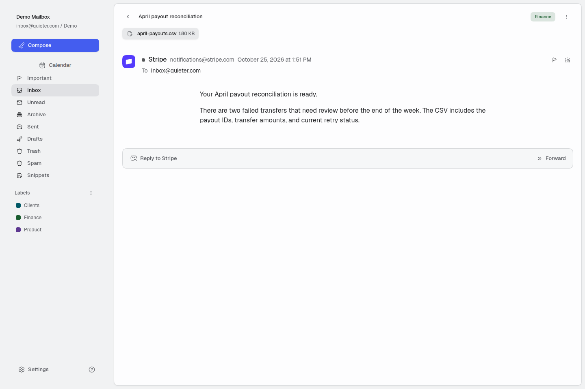 |
| One-panel inbox, dark | 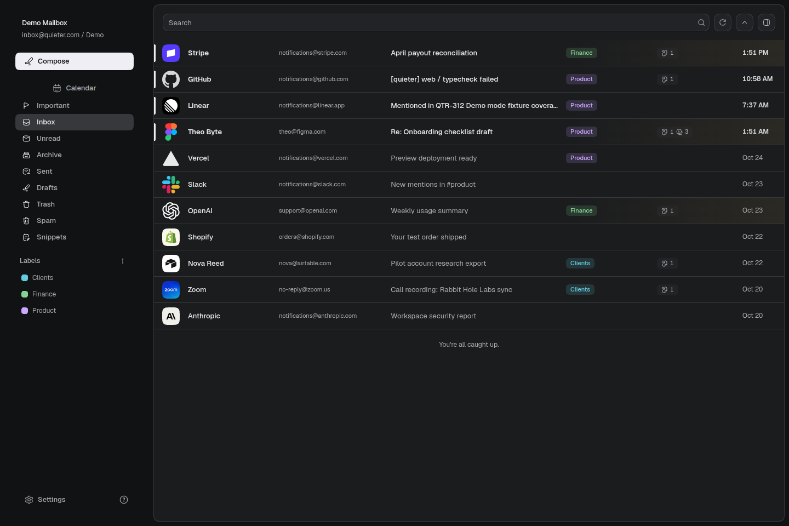 |
| One-panel conversation, dark | 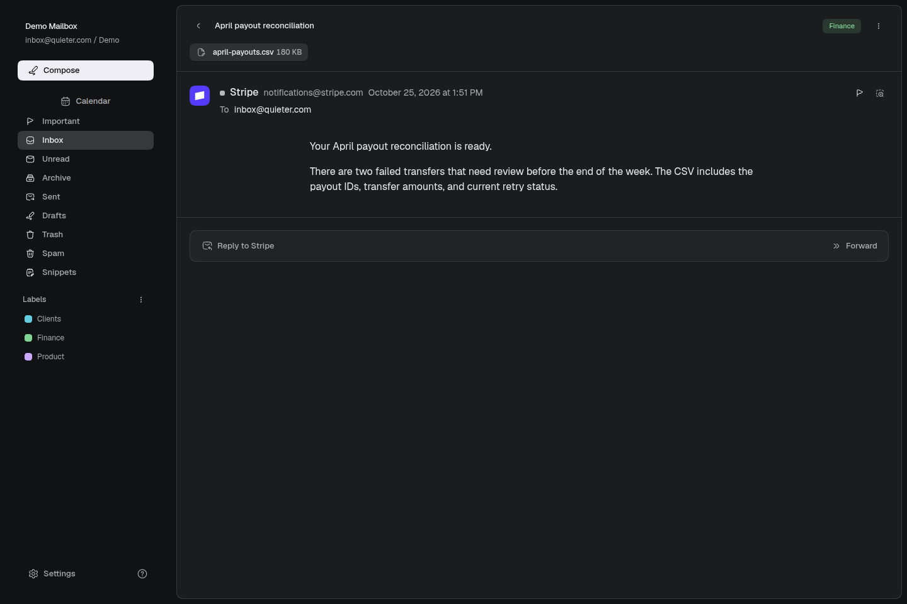 |
| All inboxes in one panel | 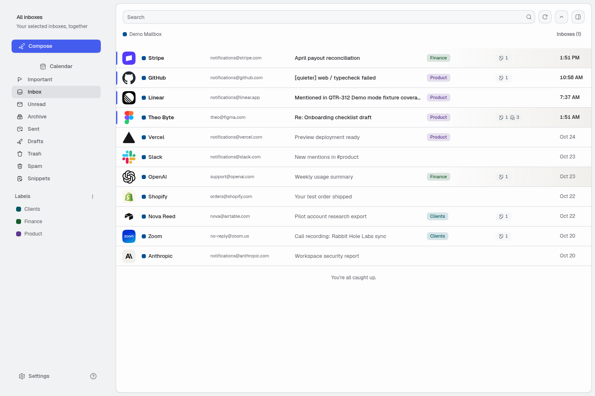 |
| All inboxes conversation and Back | 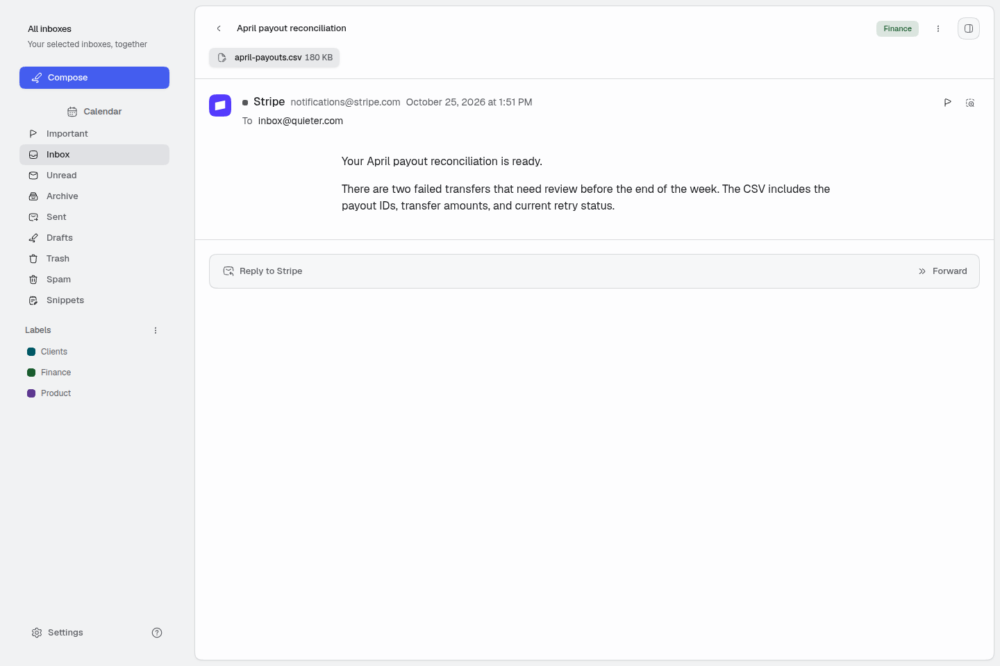 |
| Mail layout choice | 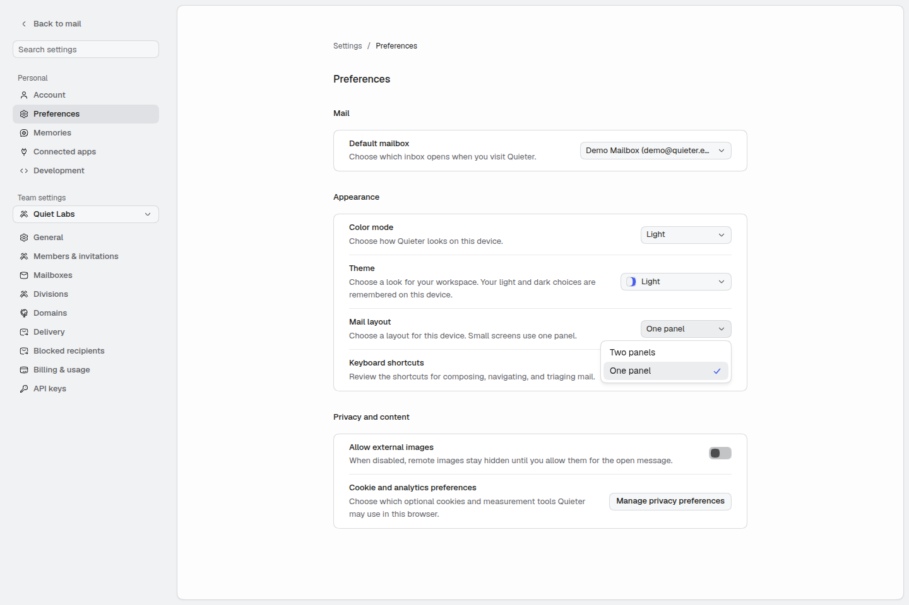 |
| Add mailbox, narrow | 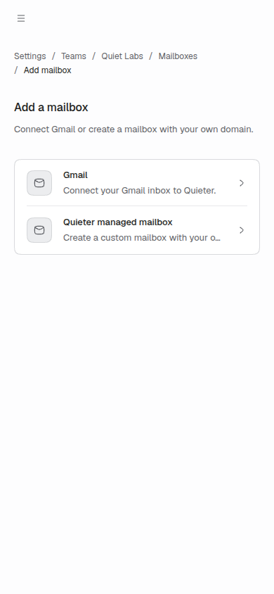 |
| Gmail connection setup | 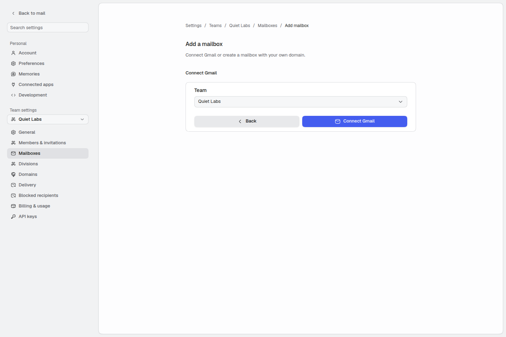 |
| Managed mailbox address | 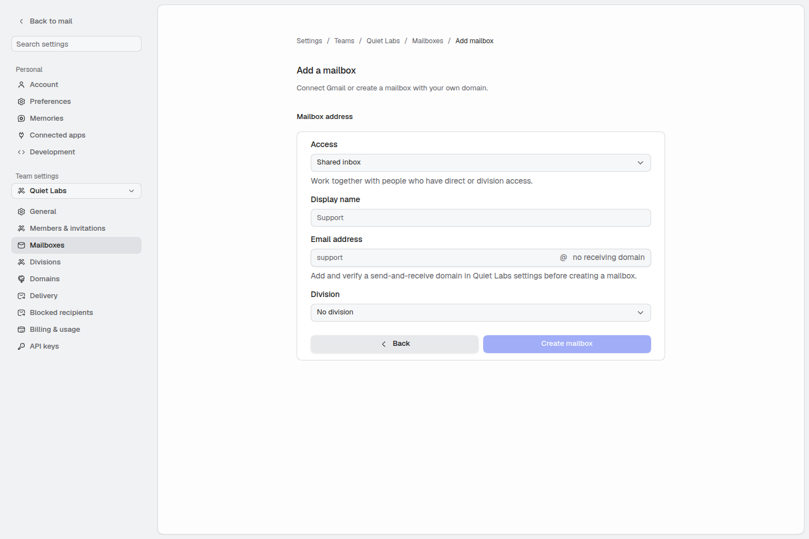 |
| Managed mailbox address, narrow | 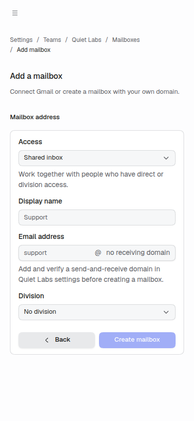 |
| One-panel inbox beside the assistant | 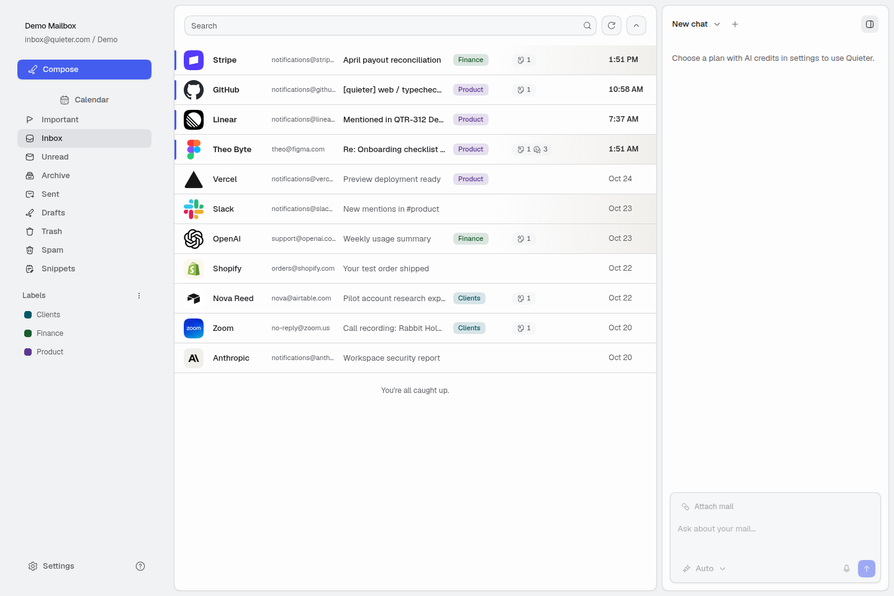 |
| Selected important message keeps its golden accent | 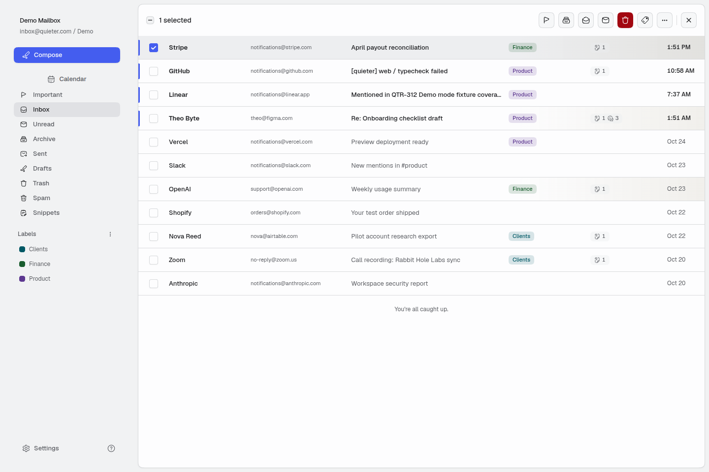 |
| Visible unsubscribe action and inactive importance flag | 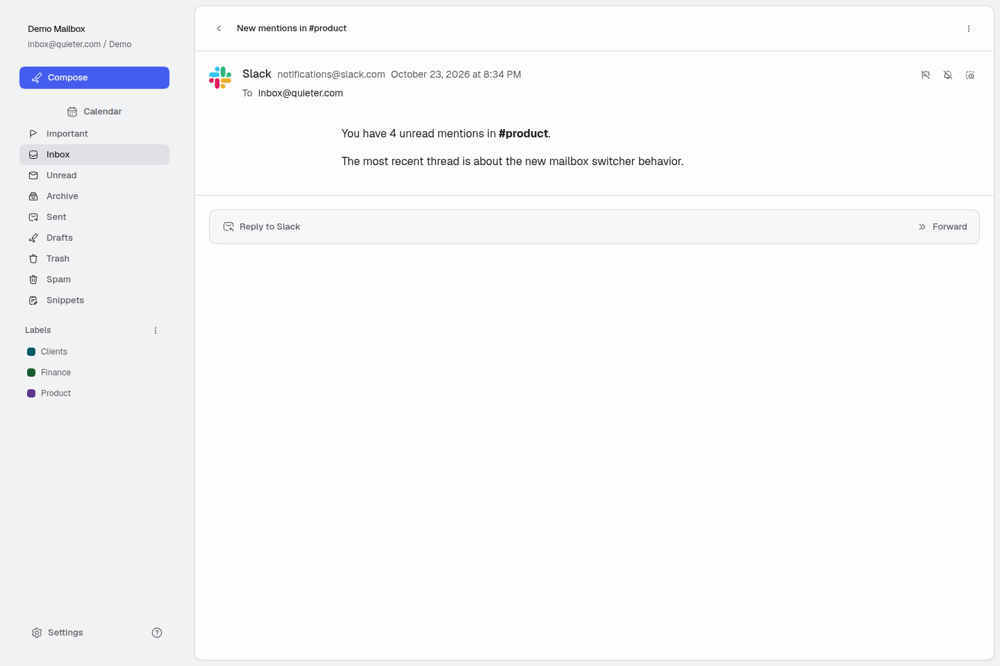 |
| Persistent unsubscribe check and active importance flag | 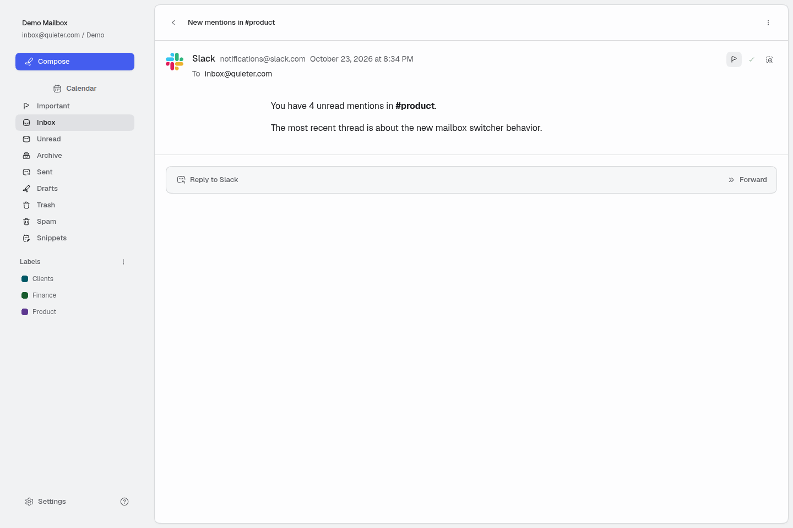 |
| Mobile managed setup without an outer frame | 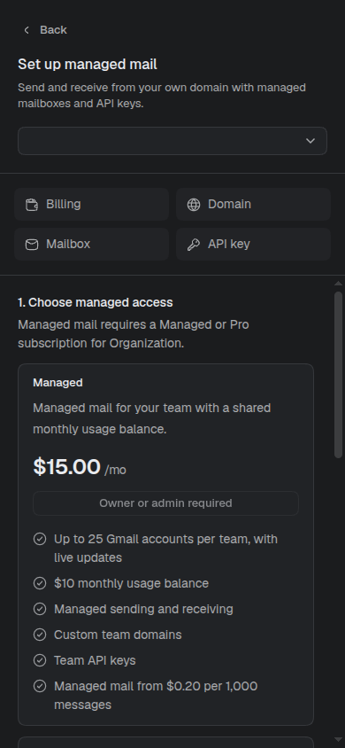 |
